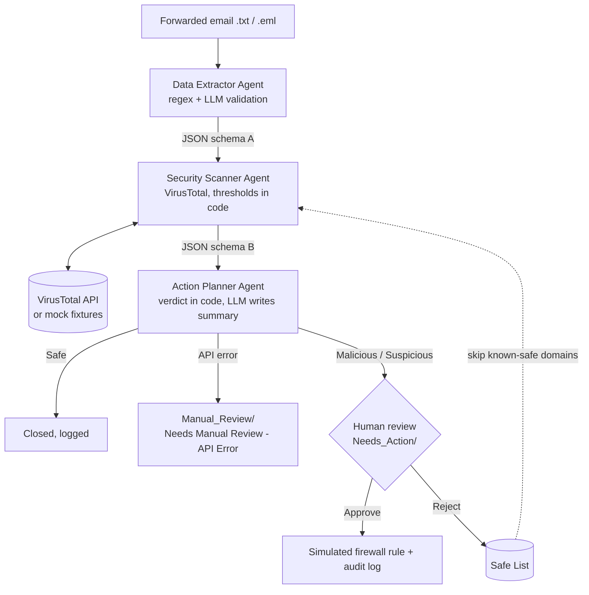

# Automated Phishing Incident Response System

A multi-agent backend prototype (Python + LangChain) that automates the repetitive research part of
phishing incident response. Three specialised agents extract indicators from a forwarded email, check
them on VirusTotal and prepare a block plan. **Nothing is blocked automatically: a human approves or
rejects every plan**, and rejections teach the system through a Safe List.

The architecture is inspired by industry-standard SOAR (Security Orchestration, Automation and Response)
workflows, such as Palo Alto Cortex XSOAR, but modernised with agentic AI.

Prepared by Aamna Ansari, AI Engineering Intern.

## Architecture



| Agent | Decides | Uses LLM? |
|---|---|---|
| Data Extractor | Which URLs, IPs and emails are real indicators | Yes, only to *remove* obvious noise (guarded by code rules) |
| Security Scanner | Risk level: Safe / Suspicious / Malicious (thresholds in `config.py`) | No |
| Action Planner | Whether to draft a block plan, close the ticket or send it to manual review | Only to write the summary text |

Agents pass structured JSON to each other (`extractor_output_v1` -> `scanner_output_v1` -> `approval_draft_v1`).

## Setup

```bash
python -m venv venv
venv\Scripts\activate            # Mac/Linux: source venv/bin/activate
pip install -r requirements.txt
copy .env.example .env           # Mac/Linux: cp .env.example .env   then fill in the keys
```

`.env` settings:

| Key | Meaning |
|---|---|
| `MOCK_MODE` | `true` = fake VirusTotal answers from `data/mock_vt_responses.json` (no key needed), `false` = real API |
| `VT_API_KEY` | VirusTotal key (free tier: about 4 requests/minute) |
| `LLM_PROVIDER`, `LLM_API_KEY`, `LLM_MODEL` | Only needed for `--llm` (groq, gemini or openai) |

## Usage

```bash
python main.py              # run every email in data/emails/ (mock mode by default)
python main.py --llm        # also use the LLM (extractor validation + plan summaries)
python main.py --live       # use the real VirusTotal API
python main.py --watch      # keep running and pick up new emails dropped into data/emails/
python main.py --chain      # same three agents as one LangChain pipeline (extractor | scanner | planner)
python review_cli.py        # human approve / reject, and closing manual-review cases
python run_demo.py          # run the 3 evaluation scenarios automatically (isolated folder)
python evaluate.py          # accuracy table: system verdict vs true label of each dummy email
python time_study.py        # measure the manual workflow by hand (real baseline for the time comparison)
python compare_agents.py    # single-LLM-agent baseline vs this pipeline (needs an LLM key)
python generate_report.py   # write outputs/reports/final_report.md
python -m unittest discover -s tests -t . -v    # run all tests
```

## Project structure

```
agents/      extractor_agent.py, validator.py, scanner_agent.py, planner_agent.py
tools/       email_loader.py, vt_client.py, safe_list.py, plan_store.py, review_service.py,
             activity_log.py, llm_factory.py, notifier.py, inbox_watcher.py, firewall.py
data/        emails/ (dummy test emails), mock_vt_responses.json, ground_truth.json
storage/     Needs_Action/, Approved/, Rejected/, Manual_Review/, Resolved/, Safe_List.json
outputs/     extracted/, scans/, logs/ (audit_log.jsonl, firewall_sim.log, pipeline.log,
             run_summary.json), reports/ (final_report.md, scenario_results.json, accuracy_*, agent_comparison.*), notifications/, firewall/ (exported blocklists), demo_run/
tests/       unit and integration tests
main.py  review_cli.py  run_demo.py  evaluate.py  time_study.py  compare_agents.py
generate_report.py  config.py
```

## Test scenarios (`python run_demo.py`)

| ID | Scenario | What it proves |
|---|---|---|
| S1 | Malicious email -> plan -> human approval | The AI only proposes; the block rule is logged after approval |
| S2 | VirusTotal API failure | The pipeline does not crash; the email is tagged "Needs Manual Review - API Error" |
| S3 | Reject -> Safe List -> re-run | A false positive is not flagged again and VirusTotal is not even called |

## Design decisions

- **Hybrid LLM use.** Verdicts and block rules come from deterministic code, so they are testable and
  cannot be hallucinated. The LLM can only remove noise (it cannot add or hide a threat) and write text.
- **Fail safe.** If VirusTotal fails, the result is "Unknown", never "Safe", and a human reviews it.
- **Rate limiting and retries** protect the free VirusTotal quota; retries are only used for timeouts,
  network and 5xx errors.
- **Audit trail.** Every human decision is written to `outputs/logs/audit_log.jsonl`.

## How the implementation relates to the proposal

| Proposal | Implementation |
|---|---|
| Backend team that automatically catches forwarded emails | `main.py --watch` picks up new files in `data/emails/` (production: Gmail / Outlook Graph API) |
| Admin clicks "Approve" | Approve / reject in the console tool `review_cli.py` (web dashboard is future work) |
| Planner saves a summary in `Needs_Action` | Done: JSON approval drafts in `storage/Needs_Action/` |
| Firewall is updated | Approved rules are logged to `outputs/logs/firewall_sim.log` and exported as plain-text blocklists in `outputs/firewall/` (domains, IPs, URLs) that a firewall or DNS filter can import. Nothing is pushed to a live firewall automatically |
| Employee is told the result | Simulated reply files in `outputs/notifications/` |
| API failure: tag "Needs Manual Review - API Error" and forward to the IT team | Tagged, saved in `Manual_Review/`, escalation file for the IT team, and the admin can close the case in `review_cli.py` |
| Rejection teaches the system | Rejected domains go to the Safe List and are skipped (VirusTotal is not even called) |
| LangChain for agent logic | LangChain (LCEL) is used for the LLM steps (indicator validation, plan summary). The Scanner and the verdict logic are deterministic Python by design. `--chain` also runs the three agents as one LangChain pipeline |
| Agents cross-verify each other | Protection comes from deterministic guard rules (the LLM can only remove obvious noise; verdicts and block rules come from code), not from agents checking each other |
| Fewer hallucinations than a single agent | `python compare_agents.py` runs a single-LLM baseline on the same emails and VirusTotal evidence and reports invented indicators, missed threats and false alarms (see the report). Hallucination risk is reduced by design, not removed |
| Saves up to 80% of IT time | The report uses measured values where they exist: automated time per email, admin decision time (measured by `review_cli.py`) and the manual baseline (`python time_study.py`). Without them it falls back to the cited 23-27 min and an assumed 60 s. It is an indicative estimate from one person on a few dummy emails, not a benchmark |

## Limitations

- Uses dummy emails; production would read the helpdesk inbox through the Gmail / Outlook Graph API.
- URLs that VirusTotal has never seen return no detections.
- Attachments and malware sandboxing are out of scope; approved rules are exported as blocklists and are not applied to a live firewall.
- Business Email Compromise without links is not detected (see `sample_bec_03` in the accuracy table).
- Mock-mode timings exclude network latency (see the report for details).

## 5-minute demo script

1. `python main.py`: 7 emails processed, 2 closed as safe, 4 plans waiting, 1 sent to manual review.
2. `python review_cli.py`: approve the PayPal phishing plan; reject `sample_clean_02` and add its domain to the Safe List.
3. `python main.py` again: `sample_clean_02` is now closed as safe.
4. Open `outputs/logs/audit_log.jsonl` and `outputs/logs/firewall_sim.log`.
5. `python run_demo.py`, `python evaluate.py`, then `python generate_report.py`, and open `outputs/reports/final_report.md`.
